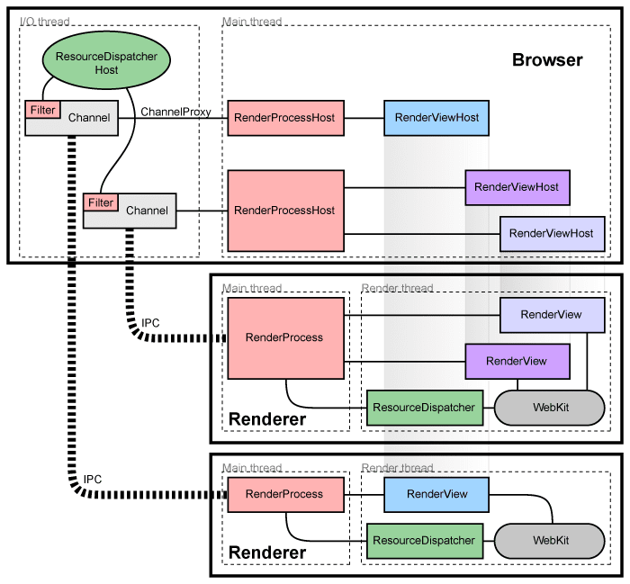
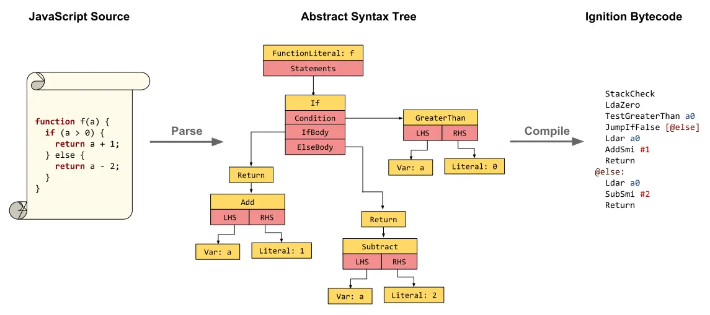
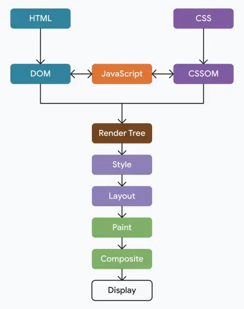

import { Alert } from '@/components/ui/feedback/Alert';
import CodeBlock from '../../../components/ui/content/CodeBlock/CodeBlock.astro';

En 1995, un «navegador» era un programa con una sola función: obtener un archivo HTML a través de HTTP y renderizar texto e imágenes en pantalla. Treinta años después, esa misma categoría de software ejecuta el lienzo colaborativo en tiempo real de Figma, decodifica video en 4K, simula físicas en juegos de WebGL/WebGPU y ejecuta gigabytes de JavaScript por sesión, superando a menudo a las aplicaciones nativas de escritorio a las que reemplazó. Esta transformación no ocurrió por casualidad. Sucedió porque un puñado de equipos de ingeniería, compitiendo por cuota de mercado, se vieron obligados a resolver problemas a nivel de sistema operativo: aislamiento de procesos, compilación en tiempo real (JIT), composición acelerada por GPU y el rediseño de protocolos en la capa de transporte.

Este artículo es un análisis a nivel de sistema sobre cómo el navegador moderno —específicamente la estirpe de Chromium que hoy impulsa Chrome, Edge, Opera, Brave y Arc— se convirtió, a todos los efectos prácticos, en un sistema operativo que se ejecuta dentro de tu propio sistema operativo.

## 1. De Netscape a Chromium: El navegador se convierte en un sistema operativo

### La primera y la segunda guerra de los navegadores

La **primera guerra de los navegadores** (1995-2001) enfrentó a Netscape Navigator contra Internet Explorer de Microsoft. La decisión de Microsoft de incluir IE directamente en Windows —gratuito, preinstalado y profundamente integrado en el entorno (*shell*) del sistema operativo— supuso una ventaja de distribución que el modelo de negocio basado en licencias de Netscape nunca pudo igualar. Para 2002, IE dominaba más del 90 % del mercado, el código fuente de Netscape se liberó como código abierto bajo el proyecto Mozilla y la innovación web se estancó prácticamente durante un lustro bajo el estancado motor de renderizado de IE6.

La **segunda guerra de los navegadores** (2004-2008) fue el contraataque de Mozilla Firefox, desarrollado sobre el motor de renderizado **Gecko**. Firefox reintrodujo la presión competitiva en torno al cumplimiento de estándares, la navegación por pestañas y la extensibilidad, recuperando una cuota de mercado significativa frente a un acomodado IE.

Luego, en septiembre de 2008, Google lanzó Chrome. No solo aportó un motor de JavaScript más rápido (V8, analizado más adelante), sino que introdujo un *modelo de procesos* fundamentalmente diferente de lo que era una pestaña del navegador. El motor de renderizado de Chrome comenzó como un fork de **WebKit** de Apple (a su vez derivado de KHTML); en 2013, Google hizo un fork de WebKit para crear **Blink**, y desde entonces Blink se ha convertido en el sustrato *de facto* de la web. Microsoft Edge abandonó su propio motor EdgeHTML en favor de Blink en 2020. El resultado es un casi monopolio conocido habitualmente como la **hegemonía de Chromium**: la mayoría de los navegadores de consumo actuales comparten el mismo núcleo de renderizado, diferenciándose principalmente en la interfaz de usuario (*UI chrome*) y las configuraciones de privacidad predeterminadas.

<Alert variant="info">
**Por qué esto es importante para los ingenieros:** Dado que el comportamiento de Blink/V8 es ahora el estándar web *de facto* en lugar de ser simplemente *una* implementación más del estándar, comprender su funcionamiento interno —no solo el texto de la especificación del W3C— marca a menudo la diferencia entre un código que simplemente funciona y un código con alto rendimiento.
</Alert>

### De visor de documentos a entorno de ejecución de aplicaciones

Las exigencias técnicas impuestas a un navegador se multiplicaron en varios órdenes de magnitud a medida que la web evolucionaba de documentos estáticos a aplicaciones: AJAX (2005) convirtió las páginas en clientes con estado que obtenían datos sin recargar la página; las API de `<canvas>` y posteriormente WebGL transformaron el navegador en un objetivo de renderizado con acceso a la GPU; Node.js demostró que JavaScript podía ejecutarse en el lado del servidor a gran escala, lo que a su vez impulsó la inversión en los motores de JS del navegador; y las aplicaciones web progresivas (PWA) desdibujaron por completo la frontera entre «sitio web» y «aplicación instalada».

Un navegador capaz de ejecutar Google Docs, un juego 3D multijugador y una videollamada en directo simultáneamente en diferentes pestañas no es un visor de documentos. Es un **entorno de ejecución multitenant** (multiinquilino) y necesitaba una arquitectura a la altura.

### La victoria arquitectónica de Chrome: Todo en multiproceso

Los navegadores anteriores a Chrome eran en su mayoría aplicaciones de **un solo proceso y multihilo**. Cada pestaña, cada extensión y la propia interfaz del navegador compartían un único espacio de direcciones. Una sola etiqueta `<script>` mal formada, un complemento defectuoso o un error en el renderizador podían bloquear todas las pestañas abiertas simultáneamente; y como todo compartía memoria, un fallo de renderizado en una pestaña era una posible brecha de seguridad para acceder a los datos de otra pestaña.

La decisión arquitectónica fundamental de Chrome fue dividir el navegador en procesos cooperativos a nivel de sistema operativo:

- **Proceso del navegador (*Browser Process*)**: el orquestador privilegiado. Posee la interfaz de usuario (barra de direcciones, marcadores, barra de pestañas), gestiona la caché de disco y es el único proceso con acceso no restringido a la red y al sistema de archivos.
- **Procesos renderizadores (*Renderer Processes*)**: uno (o más) por pestaña/sitio, ejecutando Blink y V8. Están deliberadamente **aislados en un entorno de pruebas (*sandboxed*)**: un proceso renderizador no puede tocar directamente el sistema de archivos, no puede realizar llamadas al sistema (*syscalls*) arbitrarias y debe solicitar al proceso del navegador cualquier acción privilegiada mediante comunicación entre procesos (IPC).
- **Proceso de GPU (*GPU Process*)**: un único proceso compartido que posee el contexto gráfico y realiza la composición, aislando el código del controlador de la GPU (frágil y propenso a fallos) tanto del navegador como de los renderizadores.
- **Proceso de red, procesos de utilidad, procesos de extensiones**: una descomposición adicional para el análisis sintáctico (*parsing*), el audio y el código de extensiones de terceros.

Figura 1: Arquitectura multiproceso de Chromium. El proceso principal del navegador orquesta la interfaz de usuario y las operaciones de red mientras se comunica con procesos renderizadores aislados (*sandboxed*) a través de canales de comunicación entre procesos (IPC) para aplicar los límites de seguridad.

La victoria inmediata y visible fue la contención de fallos: una pestaña podía bloquearse —la infame página «¡Vaya! Se ha producido un error...»— sin arrastrar a las otras veinte pestañas abiertas en la ventana. La ventaja más profunda fue la seguridad: al estar los procesos renderizadores aislados en *sandbox* y ser tratados como **no confiables**, un fallo de ejecución remota de código en el analizador HTML de Blink ya no le da al atacante el control de toda tu máquina; solo le otorga un proceso aislado casi sin privilegios, que luego tendría que encontrar un *segundo* fallo independiente de fuga de *sandbox* para causar un daño real.

### Site Isolation: Blindaje tras Spectre

La arquitectura multiproceso por sí sola no era suficiente. En sus inicios, Chrome agrupaba las pestañas por proceso de forma algo laxa (a menudo por pestaña, pero no estrictamente por origen), lo que significaba que un `<iframe>` de `evil.example` incrustado dentro de `trusted-bank.example` aún podía compartir un proceso renderizador —y, por tanto, un espacio de direcciones— con su página principal.

La divulgación en 2018 de la vulnerabilidad de canal lateral por ejecución especulativa **Spectre** cambió la ecuación por completo. Spectre demostró que un script malicioso podía potencialmente leer memoria arbitraria *dentro de su propio proceso* explotando la ejecución especulativa de la CPU, lo que significaba que el aislamiento de procesos ya no era suficiente si el código hostil y el de confianza compartían el mismo proceso. La respuesta de Chrome fue **Site Isolation** (aislamiento de sitios): cada sitio distinto (aproximadamente, esquema + dominio registrable) obtiene su propio proceso renderizador, incluso para los iFrames de origen cruzado (*cross-origin*) anidados dentro de otra página. La comunicación entre procesos entre una página y sus iFrames se realiza íntegramente a través de IPC, por lo que no hay memoria compartida que una lectura al estilo Spectre pueda explotar.

<Alert variant="warning">
**El coste del aislamiento:** Site Isolation no es gratuito. Una página con una docena de iFrames de anuncios y analíticas de origen cruzado puede iniciar una docena de procesos renderizadores adicionales, cada uno con su propio consumo base de memoria (el *heap* de V8, las estructuras DOM de Blink, búferes IPC). Esta es la razón principal por la que a menudo se critica el consumo de RAM de Chrome por pestaña: es un intercambio directo y deliberado de memoria a cambio de seguridad y estabilidad.
</Alert>

## 2. El motor V8: Cómo acelerar un lenguaje dinámico

JavaScript se diseñó en diez días en 1995 como un lenguaje de comandos ligero (*scripting*) para servir de unión (*glue language*). Es de tipado dinámico, cuenta con recolector de basura (*garbage collector*) y permite que las formas de los objetos muten en tiempo de ejecución, ninguna de las cuales son propiedades que faciliten una ejecución rápida. El motor **V8** de Google, incluido por primera vez en Chrome, es la razón por la que JavaScript compite hoy con lenguajes de compilación estática en cargas de trabajo del mundo real. Lo consigue mediante un *pipeline* de tres niveles: un intérprete de inicio rápido, un compilador de nivel intermedio que reduce la brecha de latencia y un compilador optimizador especulativo de máximo nivel.

Figura 2: El pipeline de análisis sintáctico (*parsing*) y generación de bytecode en V8. El código fuente de JavaScript se analiza sintácticamente en un árbol de sintaxis abstracta (AST), que el intérprete Ignition compila directamente en bytecode basado en registros antes de la ejecución.

### Ignition: El intérprete de bytecode

Cuando V8 recibe tu código JavaScript por primera vez, no lo compila directamente a código máquina. El analizador (*parser*) construye un árbol de sintaxis abstracta (AST) e **Ignition**, el intérprete de V8, compila ese AST en un **bytecode** compacto basado en registros. El bytecode es mucho más pequeño que el código máquina equivalente y se puede generar de forma casi instantánea, lo cual es crítico para el rendimiento de carga de la página, ya que los usuarios están esperando a ese primer renderizado (*first paint*).

Ignition ejecuta este bytecode directamente y, fundamentalmente, también **genera perfiles (*profiling*)** de la ejecución mientras se ejecuta: qué funciones se invocan con frecuencia, qué puntos de llamada (*call sites*) observan tipos de argumentos estables y qué ramas están calientes (*hot*). Estos datos de perfilado son el combustible para los niveles superiores.

### Maglev: Reduciendo la brecha de latencia

El bytecode de Ignition hace que el código se ejecute de forma casi instantánea, pero un intérprete paga un coste de despachado (*dispatch*) por instrucción en cada ejecución: algo aceptable para una función llamada dos veces, pero desastroso para una invocada decenas de miles de veces dentro de un bucle optimizado (*hot loop*). La solución evidente es compilar directamente a código máquina nativo. Sin embargo, el compilador de nivel superior de V8, TurboFan, es deliberadamente pesado: construye una representación en grafo completa de la función y la procesa a través de un largo *pipeline* de pasadas de optimización iterativas (*inlining*, análisis de escape, análisis de rango, eliminación de carga/almacenamiento) que producen un código máquina excelente a cambio de tiempo de compilación y memoria reales. Lanzar TurboFan en cada función en el momento en que parece estar simplemente «tibia» desperdiciaría un enorme presupuesto de CPU compilando código que quizás solo se ejecute unas pocas cientos de veces más antes de que el usuario cambie de página.

**Maglev** existe para reducir esa brecha. Introducido como el compilador JIT de nivel intermedio de V8, se ubica directamente entre Ignition y TurboFan en el *pipeline*. En lugar de construir y reescribir iterativamente un grafo pesado, Maglev realiza una **compilación en una sola pasada (*single-pass*)** directamente sobre el bytecode de Ignition, construyendo una representación en **asignación única estática (SSA, *Static Single Assignment*)** —donde a cada variable se le asigna un valor exactamente una vez, simplificando el análisis del flujo de datos— y reduciéndola directamente a código máquina nativo en una sola pasada lineal, omitiendo las rondas de reescritura iterativa de grafos en las que se basa TurboFan. El resultado no está tan agresivamente optimizado como el de TurboFan, pero es verdadero código máquina nativo, compilado en una fracción del tiempo, y supera con creces al bytecode interpretado.

Esto le da a V8 un proceso de aceleración gradual: Ignition ejecuta una función desde su primera llamada con una latencia de compilación prácticamente nula; una vez que la función demuestra estar simplemente «tibia», V8 la eleva a Maglev para obtener código nativo rápido y económico; y solo cuando demuestra estar real y duraderamente caliente (*hot*), V8 realiza la inversión mucho mayor de elevarla a TurboFan para una optimización máxima.

<Alert variant="info">
**Por qué existe la compilación por niveles:** Compilar no es gratuito: compite con el resto de la página por el tiempo de CPU. Un intérprete puro desperdicia ciclos volviendo a despachar las mismas instrucciones calientes millones de veces; un compilador optimizador puro desperdicia ciclos optimizando en profundidad código que nunca se ejecuta el tiempo suficiente para amortizar su propio coste de compilación. La única razón de existir de Maglev es abaratar el *punto medio* de esa curva de compensación (*trade-off*), de modo que las costosas optimizaciones de TurboFan se reserven únicamente para el código que haya demostrado estadísticamente que las merece.
</Alert>

### TurboFan: El compilador optimizador

Una vez que una función demuestra no estar simplemente tibia sino duraderamente **caliente (*hot*)** —invocada o recorrida en bucle las suficientes veces como para que el mayor coste de compilación de TurboFan se amortice con creces—, V8 se la entrega a **TurboFan**, el compilador JIT optimizador de nivel superior. TurboFan toma la retroalimentación de tipos acumulada por Ignition y Maglev y genera el código máquina nativo más agresivamente optimizado que V8 puede producir, especializado para los tipos que realmente ha observado; por ejemplo, asumiendo que el parámetro de una función es siempre un entero pequeño y eliminando la comprobación genérica de tipos y el coste adicional de empaquetado/desempaquetado (*boxing/unboxing*) que requeriría una implementación totalmente general.

Esto es fundamentalmente una **optimización especulativa**: TurboFan apuesta a que el comportamiento pasado de los tipos predice su comportamiento futuro. Si más adelante se viola esa apuesta —una función que siempre recibía enteros de repente recibe una cadena de texto (*string*)—, V8 debe **desoptimizar (*deoptimize*)**, descartando el código máquina especializado y volviendo a un nivel inferior —el código de Maglev o, en última instancia, el bytecode de Ignition— antes de volver a optimizar más adelante con suposiciones más amplias. La desoptimización frecuente es una de las fuentes más comunes, y más invisibles, de degradación del rendimiento en JavaScript.

<Alert variant="warning">
**Trampas de desoptimización:** Los puntos de llamada polimórficos (una función invocada con muchas formas de argumentos diferentes), la mezcla de tipos dentro de un mismo array y la modificación de la estructura de un objeto después de su construcción se encuentran entre las formas más comunes de forzar a V8 a abandonar las rutas de código optimizadas en mitad de la ejecución.
</Alert>

### Hidden Classes: Simulando una estructura estática

He aquí el problema fundamental: en un lenguaje de tipado estático, el compilador sabe en tiempo de compilación exactamente dónde se encuentra cada propiedad de un objeto en la memoria, por lo que `obj.x` se compila como una lectura con un desplazamiento (*offset*) de memoria fijo. En JavaScript, los objetos son diccionarios dinámicos —se pueden añadir o eliminar propiedades en cualquier momento—, por lo que una implementación ingenua requeriría una búsqueda en una tabla hash para *cada acceso a una propiedad*, lo cual resulta desastrosamente lento a gran escala.

La solución de V8 son las **clases ocultas (*Hidden Classes*, llamadas internamente *Maps***, que no deben confundirse con el tipo `Map` de JS). Cada objeto JavaScript está asociado en secreto a una clase oculta que describe su «forma» (*shape*) actual: qué propiedades tiene y en qué desplazamiento (*offset*) se encuentra cada una. Cuando dos objetos se construyen con propiedades añadidas en el mismo orden, V8 reconoce que comparten la misma forma y les asigna la *misma* clase oculta, lo que significa que el acceso a la propiedad ahora se puede compilar en una lectura directa por desplazamiento, igual que en un lenguaje estático.

En el momento en que cambia la forma de un objeto —se añade una nueva propiedad o se elimina una—, V8 debe realizar una transición hacia una *nueva* clase oculta. Si dos constructores crean objetos lógicamente similares pero asignan propiedades en órdenes diferentes, V8 genera cadenas de transición de clases ocultas totalmente distintas para cada uno, anulando esta optimización:

export const hiddenClassCode = `// Estos dos objetos terminan con clases ocultas (hidden classes) DIFERENTES,
// aunque al final tienen las "mismas" propiedades,
// porque el ORDEN de inserción de las propiedades difiere.

function PointGood(x, y) {
  this.x = x; // Transición: {} -> {x}
  this.y = y; // Transición: {x} -> {x, y}
}

function PointBad(x, y) {
  this.y = y; // Transición: {} -> {y}
  this.x = x; // Transición: {y} -> {y, x}   <-- ¡cadena diferente!
}

const a = new PointGood(1, 2);
const b = new PointBad(1, 2);

// a y b tienen ahora dos clases ocultas DIFERENTES internamente,
// aunque Object.keys(a) y Object.keys(b) parezcan idénticos.
// Cualquier código que opere en arrays que mezclen ambas formas
// forzará a las cachés en línea (inline caches) de V8 a un estado "polimórfico" más lento.
`;

<CodeBlock 
  code={hiddenClassCode} 
  filename="hidden_classes.js" 
  showLineNumbers={true} 
/>

### Inline Caching: Recordar la última forma vista

Las clases ocultas resuelven *cómo* ocurre la búsqueda de una propiedad; el **almacenamiento en caché en línea (*Inline Caching* o IC)** resuelve *qué tan rápido* ocurre en un punto específico de tu código. Cada punto de acceso a una propiedad (un punto de llamada o *«call site»*, por ejemplo, la línea específica `obj.x`) mantiene una pequeña caché que recuerda qué clase oculta vio la última vez y el desplazamiento (*offset*) de memoria resultante. En la siguiente ejecución de esa misma línea, V8 comprueba: «¿es la clase oculta de este objeto la misma que la última vez?». Si la respuesta es afirmativa, omite la búsqueda por completo y salta directamente al desplazamiento almacenado en caché.

Las cachés en línea pasan por tres estados:

- **Monomórfico (*Monomorphic*)**: el punto de llamada solo ha visto una única clase oculta. Esta es la ruta más rápida posible.
- **Polimórfico (*Polymorphic*)**: el punto de llamada ha visto un número pequeño y acotado de clases ocultas distintas (V8 almacena en caché varias y comprueba cada una). Sigue siendo bastante rápido.
- **Megamórfico (*Megamorphic*)**: el punto de llamada ha visto demasiadas formas distintas como para que valga la pena almacenarlas en caché. V8 abandona la ruta rápida de IC y recurre a una búsqueda de propiedades genérica y mucho más lenta.

Esta es precisamente la razón por la que las bibliotecas y las guías de estilo insisten en una construcción consistente de los objetos (conjuntos fijos de propiedades, orden de inserción uniforme, evitar el uso de `delete`): no se trata de una superstición, sino de mantener las cachés en línea en estado monomórfico.

## 3. La ruta de renderizado crítica: De bytes a píxeles

Una vez que V8 ha ejecutado tus scripts, el navegador todavía tiene que convertir un documento junto con sus estilos en una imagen real en una pantalla física, idealmente 60 (o 120) veces por segundo. Este *pipeline* —la **ruta de renderizado crítica (*Critical Rendering Path*)**— es donde los bytes de la red se convierten en píxeles.

Figura 3: El pipeline de la ruta de renderizado crítica. El navegador analiza sintácticamente HTML y CSS en los árboles DOM y CSSOM, los combina en un árbol de renderizado (*Render Tree*) y ejecuta las pasadas de maquetación (*Layout*), pintado (*Paint*) y composición (*Compositing*) para renderizar el fotograma final en pantalla.

### Construcción del DOM y del CSSOM

A medida que llegan los bytes de HTML, el analizador (*parser*) de HTML de Blink los convierte en tokens de forma incremental y construye el árbol **DOM (Document Object Model)**: una representación viva y estructurada de cada elemento y nodo de texto. El análisis sintáctico se realiza en *streaming* y de forma incremental por diseño: el navegador no espera a recibir el documento completo antes de comenzar a construir el árbol, razón por la cual un **analizador de precarga (*preload scanner*)** se ejecuta por delante del analizador principal, detectando las etiquetas ``, `<link>` y `<script>` de forma anticipada para iniciar las peticiones de red antes de que el analizador principal llegue siquiera a ellas.

En paralelo, el CSS —ya sea de bloques `<style>` o de hojas de estilo vinculadas— se analiza sintácticamente en el **CSSOM (CSS Object Model)**, un árbol de reglas de estilo con especificidad calculada y resolución de cascada. La construcción del CSSOM **bloquea el renderizado (*render-blocking*)**: dado que cualquier regla de una hoja de estilo posterior podría en principio sobrescribir una anterior, el navegador no puede comenzar a pintar de forma segura hasta que disponga del CSSOM completo (esta es también la razón del clásico consejo de rendimiento de mantener las hojas de estilo pequeñas y cargarlas lo antes posible).

### Render Tree, Layout y Paint

Con el DOM y el CSSOM disponibles, Blink los combina en el **árbol de renderizado (*Render Tree*)**: esencialmente el DOM, pero filtrado para incluir solo los nodos que realmente serán visibles (los elementos con `display: none` se excluyen por completo, aunque los elementos con `visibility: hidden` sí se incluyen ya que siguen ocupando espacio), anotados con sus estilos calculados finales.

El *Render Tree* solo sabe *qué* dibujar, no *dónde*. La **maquetación o diseño (*Layout*, a veces llamado *reflow*)** recorre el árbol y calcula la geometría exacta del modelo de caja —posición, anchura, altura, márgenes— para cada uno de los nodos, en relación con la ventana gráfica (*viewport*). Esta es por naturaleza una operación global: cambiar la anchura de un elemento puede propagarse en cascada y alterar la posición de cada elemento hermano y descendiente, razón por la cual el *Layout* es una de las etapas más costosas del *pipeline*, y por la que activarlo repetidamente en un bucle ajustado (**forzado de maquetación o *layout thrashing***, por ejemplo, leyendo `offsetHeight` y luego escribiendo un estilo en llamadas alternadas) es un clásico antipatrón de rendimiento.

Una vez fijada la geometría, el **pintado (*Paint*)** rasteriza cada elemento visible en píxeles reales —rellenando texto, colores, bordes, sombras e imágenes—, registrados como una lista ordenada de comandos de dibujo (rectángulos, secuencias de glifos, mapas de bits) por capa.

### Composición (Compositing): Delegando en la GPU

La etapa final, la **composición (*Compositing*)**, es lo que hace posible un desplazamiento (*scrolling*) y unas animaciones infinitamente fluidas. Ciertos elementos —aquellos con un `transform` de CSS, una transición de `opacity`, una indicación `will-change`, `<video>` o `<canvas>`— se elevan a su propia **capa de composición (*compositor layer*)**, esencialmente una textura independiente. Estas capas se entregan al proceso de GPU, que las compone en un **hilo de composición (*compositor thread*)** dedicado, completamente separado del hilo principal de JavaScript, maquetación y pintado.

La ventaja: animar `transform` y `opacity` puede omitir el *Layout* y el *Paint* por completo y ser gestionado puramente por la GPU reubicando texturas ya rasterizadas, razón por la cual estas dos propiedades pueden alcanzar unos fluidos 60/120 fps incluso cuando el hilo principal está ocupado ejecutando JavaScript. Por el contrario, animar `width`, `top` o `left` fuerza un ciclo completo de Layout → Paint → Composite en cada fotograma (*frame*), ya que la propia geometría está cambiando.

export const compositingHintCode = `/* Económico: se eleva a su propia capa de GPU, se anima en el
   hilo del compositor — omite Layout y Paint por completo. */
.modal-cheap {
  transform: translateY(20px);
  opacity: 0.9;
  will-change: transform, opacity;
}

/* Costoso: fuerza un pase completo de Layout -> Paint -> Composite
   en cada fotograma de animación, en el hilo principal. */
.modal-expensive {
  top: 20px;
  left: 50%;
  width: 320px;
}
`;

<CodeBlock 
  code={compositingHintCode} 
  filename="compositing_hints.css" 
  showLineNumbers={true} 
/>

 

<Alert variant="info">
**`will-change` es un bisturí, no un martillo:** Elevar un elemento a su propia capa de composición consume memoria de la GPU (cada capa es una textura completa). El uso excesivo de `will-change` en muchos elementos puede *perjudicar* el rendimiento al agotar la memoria de la GPU y forzar una gestión excesiva de capas; debe aplicarse de forma puntual, justo antes de que comience una animación, y retirarse después.
</Alert>

## 4. Protocolos de red que impulsan la web: De HTTP/1.1 a HTTP/3

Renderizar rápido no sirve de nada si los bytes tardan demasiado en llegar. La capa de transporte que subyace al navegador ha sufrido un rediseño tan radical como el del propio motor de renderizado.

### HTTP/1.1 y el problema del bloqueo de cabeza de línea (*Head-of-Line Blocking*)

HTTP/1.1 es un protocolo de petición-respuesta en texto plano donde, estrictamente, solo puede haber una petición pendiente por conexión TCP a la vez (el *pipelining* —enviar múltiples peticiones sin esperar las respuestas— estaba técnicamente permitido, pero se implementó de forma tan deficiente e inconsistente en los intermediarios que los navegadores nunca lo habilitaron por defecto). Para lograr cierto paralelismo, los navegadores recurrieron a abrir múltiples conexiones TCP simultáneas por origen —habitualmente limitadas a unas seis—, un truco que funciona pero que conlleva costes reales: cada conexión necesita su propio *handshake* TCP y, sobre HTTPS, su propio *handshake* TLS, y cada una comienza desde una ventana de congestión inicial lenta.

### HTTP/2: Multiplexación sobre una sola conexión

HTTP/2 reemplazó el entramado de texto plano de HTTP/1.1 con una **capa de entramado binario (*binary framing layer*)**, dividiendo las peticiones y respuestas en pequeños fotogramas o tramas (*frames*) etiquetados con un ID de *stream*, todos intercalados sobre una *única* conexión TCP. Esto permite una verdadera **multiplexación**: decenas de peticiones y respuestas pueden estar en vuelo simultáneamente en una sola conexión, eliminando la necesidad del truco de las seis conexiones y la sobrecarga de *handshakes* redundantes que conllevaba. HTTP/2 también introdujo la compresión de cabeceras **HPACK** (dado que las cabeceras HTTP son extremadamente repetitivas en las peticiones al mismo origen) y, de forma más controvertida, el **server push** (abandonado en gran medida en la práctica para 2022, ya que resultó difícil de ajustar correctamente y a menudo fue superado por técnicas más simples como `<link rel="preload">`).

HTTP/2 resolvió el bloqueo de cabeza de línea a *nivel de aplicación*, pero heredó un problema más profundo de su transporte. **TCP garantiza la entrega de bytes estrictamente ordenada y en secuencia.** Si se pierde un solo paquete en cualquier punto de esa única conexión TCP compartida, *todos* los *streams* HTTP/2 multiplexados se detienen, porque TCP no entregará el búfer de recepción del kernel a la aplicación hasta que el paquete perdido sea retransmitido y el flujo de bytes vuelva a estar en orden, aunque el paquete perdido haya pertenecido a solo uno de las decenas de *streams* activos. Esto es el **bloqueo de cabeza de línea a nivel de transporte**, y ninguna astucia a nivel de aplicación puede solucionarlo mientras TCP sea el transporte subyacente.

### HTTP/3: Abandonando TCP por QUIC

La decisión que define a HTTP/3 es radical: **abandona TCP por completo** y se ejecuta sobre **QUIC**, un nuevo protocolo de transporte construido sobre UDP. Esto suena como un paso atrás —UDP no ofrece ninguna garantía de orden o fiabilidad—, pero ese es precisamente el objetivo. El propio QUIC reimplementa la fiabilidad y el control de congestión en la capa de transporte, pero, fundamentalmente, lo hace **por *stream*** en lugar de para la conexión en su conjunto. Si se pierde un paquete que transporta datos para el *stream* 4, solo el *stream* 4 se detiene a la espera de la retransmisión; los *streams* 1, 2 y 3 continúan entregando datos a la aplicación sin interrupción. El bloqueo de cabeza de línea ahora se limita al *stream* individual que realmente perdió datos, no a toda la conexión.

QUIC también fusiona los *handshakes* de transporte y criptográfico en uno solo. Mientras que históricamente TCP + TLS 1.3 requerían un *handshake* TCP *seguido de* un *handshake* TLS independiente (añadiendo idas y vueltas o *round trips*), QUIC integra TLS 1.3 directamente en su propio *handshake*, y para conexiones repetidas a un servidor que el cliente ha visitado recientemente, admite la **reanudación 0-RTT (*0-RTT resumption*)**: el cliente puede enviar datos de aplicación cifrados en su primer envío de paquetes (*flight*), utilizando parámetros criptográficos almacenados en caché de la sesión anterior, sin esperar en absoluto a un *round trip* del servidor antes de que comiencen a fluir datos útiles. (Los datos 0-RTT conllevan un riesgo teórico de ataque de repetición, razón por la cual los servidores restringen qué tipo de peticiones, típicamente las idempotentes, tienen permitido usarlos).

Otra característica de QUIC, a menudo poco valorada, es la **migración de conexiones (*connection migration*)**: dado que una conexión QUIC se identifica mediante un ID de conexión (*Connection ID*) en lugar de la tradicional tupla de 4 elementos de TCP (IP de origen, puerto de origen, IP de destino, puerto de destino), un cliente puede cambiar de red —por ejemplo, de Wi-Fi a datos móviles al salir de casa— sin interrumpir ni tener que restablecer la conexión.

| Propiedad | HTTP/1.1 | HTTP/2 | HTTP/3 |
|---|---|---|---|
| **Transporte** | TCP | TCP | QUIC sobre UDP |
| **Multiplexación** | Ninguna (requiere múltiples conexiones) | Sí, en una sola conexión | Sí, por *stream* |
| **Bloqueo de cabeza de línea (*Head-of-Line Blocking*)** | Grave (por conexión) | Solo a nivel de transporte (un paquete perdido detiene todos los *streams*) | Eliminado (aislado por *stream*) |
| **Compresión de cabeceras** | Ninguna | HPACK | QPACK |
| **Handshake** | TCP + *handshake* TLS independiente | TCP + *handshake* TLS independiente | *Handshake* combinado de transporte y cifrado |
| **Reanudación 0-RTT** | No | No | Sí |
| **Migración de conexiones** | No (vinculado a IP/puerto) | No (vinculado a IP/puerto) | Sí (basado en ID de conexión) |

<Alert variant="warning">
**UDP no siempre es bienvenido:** Dado que QUIC se ejecuta sobre UDP, algunos cortafuegos corporativos, *middleboxes* antiguos y redes restrictivas lo limitan o lo bloquean por completo, al haber sido ajustados históricamente para priorizar o esperar exclusivamente TCP. Los navegadores gestionan esto intentando siempre utilizar HTTP/3 de forma oportunista mientras alternan transparentemente a HTTP/2 sobre TCP cuando UDP no está disponible, una ruta de degradación progresiva (*graceful degradation*) que debe estar integrada en el cliente y no darse por sentada.
</Alert>

## 5. Conclusión: WebAssembly y el cierre de la brecha nativa

Cada capa cubierta hasta ahora —la arquitectura multiproceso aislada en *sandbox*, el JIT especulativo de V8, el *pipeline* de renderizado acelerado por GPU y el transporte de baja latencia de QUIC— se construyó al servicio de un único objetivo: hacer que el navegador se comporte como una plataforma de aplicaciones de primer nivel. La última gran brecha era el rendimiento computacional puro para las cargas de trabajo más pesadas: suites de edición de vídeo y fotografía, herramientas CAD, motores de juegos 3D completos y computación científica, donde incluso el código máquina optimizado de V8 conlleva una sobrecarga residual derivada de las comprobaciones de tipos dinámicos de JavaScript y las pausas del recolector de basura.

**WebAssembly (Wasm)** cierra esa brecha. Es un formato de instrucciones binarias compacto diseñado como un *objetivo* de compilación más que como un lenguaje para escribir a mano: el código en C, C++, Rust y Go se puede compilar directamente a módulos Wasm que se ejecutan dentro del mismo proceso renderizador aislado en *sandbox*, a velocidades cercanas a las del código máquina nativo, debido a que Wasm es de tipado estático y se valida de forma anticipada, evitando la sobrecarga de tipado dinámico sobre la que los motores de JavaScript tienen que especular. Los módulos Wasm comparten un búfer de memoria lineal con JavaScript y se invocan a través de un código de unión (*glue code*) ligero en JS, lo que permite trasladar bases de código nativas existentes —un motor de físicas, un códec de vídeo, un núcleo CAD— al navegador prácticamente sin modificaciones.

Así es como Figma ejecuta un motor de renderizado en C++ dentro de una pestaña, cómo AutoCAD y Photoshop ofrecen versiones para navegador con un rendimiento de edición real, y cómo Unreal Engine y Unity pueden utilizar la web como plataforma de despliegue para demos jugables. Los esfuerzos emergentes como la **Interfaz de Sistema de WebAssembly (WASI)** están impulsando ahora el modelo de ejecución portátil y en *sandbox* de Wasm completamente *fuera* del navegador, llevándolo a la computación en el borde (*edge computing*) y a entornos de ejecución en el servidor, convirtiendo una tecnología nacida para resolver un problema de rendimiento del navegador en un formato de ejecución seguro y de propósito general para la informática a gran escala.

Treinta años después de que Netscape lanzara un visor de documentos, el «navegador» es posiblemente la pieza de software de consumo más sofisticada que la mayoría de la gente ejecuta: un sistema operativo, en el sentido de ingeniería más puro, que simplemente resulta renderizarse dentro de un rectángulo en tu pantalla.

---

## Referencias y lecturas complementarias

* **V8 Development Team.** <a href="https://v8.dev/blog/ignition-interpreter" target="_blank" rel="noopener noreferrer">*Firing up the Ignition interpreter*</a>. V8.dev. Antecedentes técnicos sobre el diseño del bytecode de Ignition y su papel en el rendimiento de inicio de V8.
* **V8 Development Team.** <a href="https://v8.dev/docs/turbofan" target="_blank" rel="noopener noreferrer">*TurboFan JIT Design*</a>. V8.dev. Documentación arquitectónica sobre el compilador optimizador de V8 y su modelo de optimización especulativa.
* **Chromium Project.** <a href="https://www.chromium.org/developers/design-documents/site-isolation/" target="_blank" rel="noopener noreferrer">*Site Isolation Design Documents*</a>. Chromium.org. Justificación técnica para el aislamiento de procesos renderizadores por sitio tras la divulgación de Spectre.
* **IETF.** <a href="https://datatracker.ietf.org/doc/html/rfc9000" target="_blank" rel="noopener noreferrer">*RFC 9000: QUIC — A UDP-Based Multiplexed and Secure Transport*</a>. IETF Datatracker. La especificación formal del transporte QUIC subyacente a HTTP/3.
* **IETF.** <a href="https://datatracker.ietf.org/doc/html/rfc9114" target="_blank" rel="noopener noreferrer">*RFC 9114: HTTP/3*</a>. IETF Datatracker. Mapeo formal de las semánticas de HTTP sobre el transporte QUIC.
* **web.dev (Google).** <a href="https://web.dev/articles/critical-rendering-path" target="_blank" rel="noopener noreferrer">*Critical Rendering Path*</a>. web.dev. Documentación de referencia sobre la construcción del DOM/CSSOM, layout, paint y compositing.
* **WebAssembly Community Group.** <a href="https://webassembly.org/" target="_blank" rel="noopener noreferrer">*WebAssembly.org*</a>. Centro de especificaciones oficiales y justificación de diseño para el formato de instrucciones binarias Wasm.

---

## Glosario técnico

| Término | Definición |
|---|---|
| **Blink** | El motor de renderizado HTML/CSS de Google, derivado (*forked*) de WebKit en 2013, compartido actualmente por Chrome, Edge, Opera y la mayoría de los demás navegadores basados en Chromium. |
| **Site Isolation** | Una arquitectura de seguridad de Chromium que otorga a cada sitio distinto su propio proceso renderizador, incluyendo iFrames de origen cruzado (*cross-origin*), para defenderse contra ataques de lectura de memoria de la clase Spectre. |
| **Ignition** | El intérprete de bytecode de V8, responsable de la rápida ejecución inicial y de recopilar datos de perfilado sobre la retroalimentación de tipos (*type-feedback*). |
| **TurboFan** | El compilador JIT optimizador de V8, que genera código máquina nativo especulativamente especializado por tipos para funciones «calientes» (*hot*). |
| **Clase oculta (*Hidden Class / Map*)** | La representación interna en V8 de la «forma» (*shape*) de las propiedades de un objeto JavaScript, lo que permite un acceso a las propiedades basado en desplazamientos (*offsets*), al estilo de los lenguajes estáticos. |
| **Caché en línea (*Inline Cache / IC*)** | Una caché por punto de llamada (*call site*) que recuerda las últimas clases ocultas observadas, lo que permite a V8 omitir la búsqueda completa de propiedades en ejecuciones repetidas. |
| **CSSOM** | El CSS Object Model: una representación en árbol de las reglas de hojas de estilo analizadas, combinada con el DOM para producir el árbol de renderizado (*Render Tree*). |
| **Hilo de composición (*Compositor Thread*)** | Un hilo dedicado, independiente del hilo principal de JS/maquetación, que gestiona la composición de capas en la GPU para lograr animaciones fluidas de forma independiente del trabajo del hilo principal. |
| **Bloqueo de cabeza de línea (*Head-of-Line Blocking*)** | Una condición de bloqueo en la que la pérdida o el retraso de una unidad de datos bloquea la entrega de datos no relacionados multiplexados en el mismo canal. |
| **QUIC** | Un protocolo de transporte basado en UDP (RFC 9000) que ofrece fiabilidad por *stream*, *handshakes* TLS 1.3 integrados, reanudación 0-RTT y migración de conexiones. |
| **Reanudación 0-RTT (*0-RTT Resumption*)** | Una característica de QUIC/TLS 1.3 que permite a un cliente recurrente enviar datos de aplicación cifrados en su primer envío de paquetes (*packet flight*), sin esperar una ida y vuelta (*round trip*) del servidor. |
| **WebAssembly (Wasm)** | Un formato de instrucciones binarias de tipado estático y aislado en *sandbox*, utilizado como objetivo de compilación para obtener un rendimiento casi nativo dentro del entorno de ejecución del navegador. |