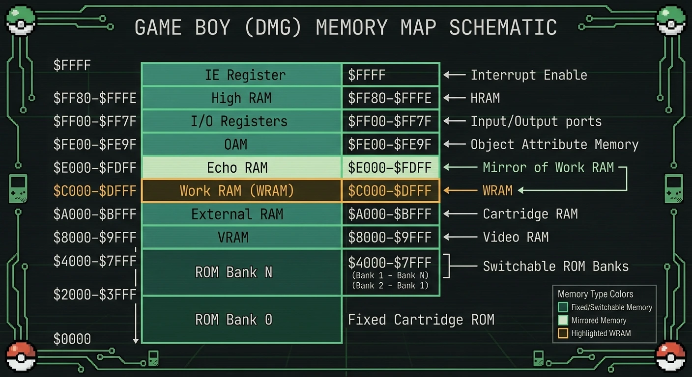
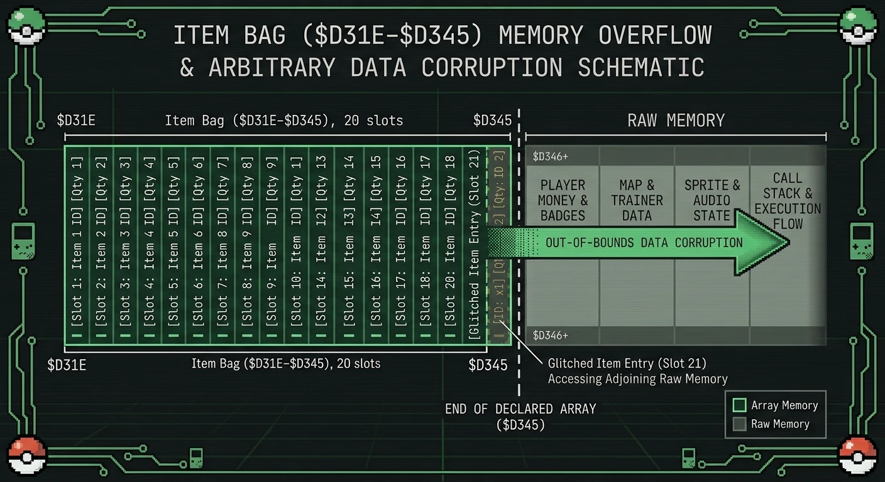
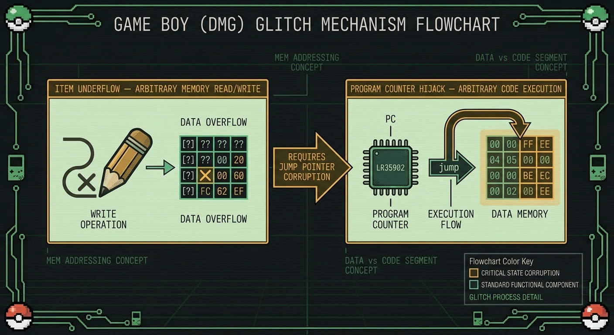
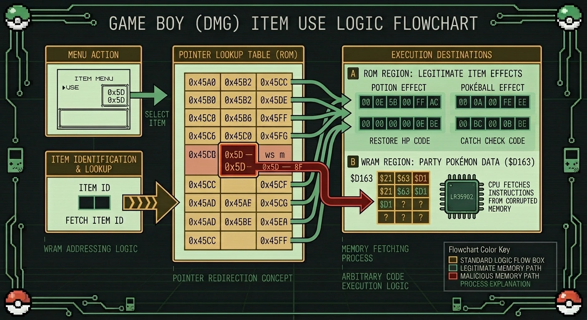

import { Alert } from '@/components/ui/feedback/Alert';
import CodeBlock from '../../../components/ui/content/CodeBlock/CodeBlock.astro';

大半のソフトウェアにおいて、クラッシュ（強制終了）は物語の終わりを意味します。しかし『ポケットモンスター 赤・緑』（海外名：Pokémon Red / Blue, 1996年）では、特定のクラッシュこそが物語の始まりでした。プレイヤーたちは、境界チェックのないゲーム内のインベントリ配列を上限を超えて走査できること、その先に存在するバイト列を通常の道具と同じように読み書きできること、そして適切なバグアイテム（バグった道具）の順序を組むことで、Sharp SM83 CPUにプレイヤーの制御下にあるデータを命令として実行させられることを発見しました。

これは比喩表現としての「バグ（グリッチ）」ではありません。厳密な意味でのメモリ破壊（Memory Corruption）です。すなわち、配列外アクセス（Out-of-Bounds）によって、最終的にプログラムカウンタ（PC）が攻撃者の制御するRAM領域へとリダイレクトされる脆弱性です。これと全く同種のバグは、数十年後のx86やARMターゲットにおけるバッファオーバーフローにも現れます。ゲームボーイ版の事例は十分にスケールが小さく、またスピードラン（RTA）やリバースエンジニアリングのコミュニティによって徹底的にドキュメント化されているため、最初に破壊された1バイトから完全なコード実行に至るまでを正確に追跡することができます。

## 1. ゲームボーイのハードウェア制約とメモリマップ

ゲームボーイのロジックボードは**Sharp SM83**を中心に構築されています。これはIntel 8080命令セットとZilog Z80拡張のサブセットを融合したカスタムコアで、クロック周波数は約4.194304 MHzです。8ビットデータバスと16ビットアドレスバスを備え、CPUにフラットな64 KBのアドレス空間（`$0000-$FFFF`）を提供します。メモリ保護、特権リング、実行許可ビットは一切ありません。CPUが読み取れるすべてのバイトは、プログラムカウンタをそこに誘導さえすれば、同様に実行させることが可能です。

| アドレス範囲 | 領域 | 備考 |
|---|---|---|
| `$0000-$3FFF` | ROMバンク0 | 固定カートリッジバンク |
| `$4000-$7FFF` | ROMバンクN | MBCにより切り替え可能 |
| `$8000-$9FFF` | VRAM | タイルおよびマップデータ |
| `$A000-$BFFF` | 外部RAM (SRAM) | バッテリバックアップ付きセーブデータ |
| `$C000-$DFFF` | ワークRAM (WRAM) | 8 KiB汎用RAM。プレイヤー、手持ち、道具の状態がここに常駐する |
| `$E000-$FDFF` | エコーRAM | `$C000-$DDFF`のミラー。下位13ビットのアドレスのみ配線されている |
| `$FE00-$FE9F` | OAM | スプライト属性テーブル |
| `$FF00-$FF7F` | I/Oレジスタ | メモリマップトハードウェア（ジョイパッド、オーディオ、PPU、タイマー） |
| `$FF80-$FFFE` | ハイRAM (HRAM) | 127バイトの高速RAM。DMA中の唯一安全なスクラッチ空間 |
| `$FFFF` | IEレジスタ | 割り込み許可フラグ |

<Alert variant="info">
**設計上のメモリ保護の欠如：** SM83にはMMU、DEP相当機能、ハードウェアでの境界チェックが一切ありません。ゲームが示すすべての安全性プロパティは、下位のチップではなく、ゲーム自体のコードのプロパティです。インベントリのルーチンがインデックスのチェックを忘れた場合、それより下位のレイヤーでその間違いが検知されることはありません。
</Alert>

*図1：ゲームボーイの16ビットアドレス空間。WRAM（`$C000-$DFFF`）は、道具バッグを含め、すべての可変プレイヤー状態を、構造ごとの独立性がない単一の無差別なブロックとして保持しています。*

プレイヤーに関する状態（手持ちのポケモン、図鑑のフラグ、マップ座標、道具バッグ）は、`$D163`付近から始まるWRAMに連続して格納されています。それらの読み書きを行うコードの厳格さ以外に、構造と構造を隔てるものは何もありません。

## 2. インベントリの仕組みと配列境界違反

道具バッグは、`$D31D`から始まる固定サイズのWRAMブロックを占有しています。レイアウトは、長さをプレフィックスとしたフラットな配列です：

- `$D31D` — 道具の総数（1バイト）
- `$D31E`, `$D31F` — 道具スロット1：`[道具ID, 個数]`
- `$D320`, `$D321` — 道具スロット2
- … 合計20スロット、`$D344`/`$D345`で終了
- `$D346` — リストのターミネータ（終端）、`$FF`が格納されていることが期待される

20スロットという制限は、基盤となる配列ロジックが強制しているものではなく、あくまで*メニュー*が強制している制限に過ぎません。カーソルやスクロールのルーチンがイテレーション（反復処理）の終了範囲を決定する際に実際に信頼しているのは、`$D31D`にある個数バイトです。もし対応する正しく境界付けられた配列がないまま、そのバイトを20より大きくさせることができれば、バッグを走査するすべてのルーチンは`$D346`を超えて読み書きを行い、そのまま処理を続行してしまいます。

これは、**255個スタックの道具増殖バグ（glitch）**によって引き起こすことができます。255個スタックされた道具の周辺で、バッグ／捨てる／入れ替えの特定の入力シーケンスをゲームが処理する際の欠陥を突くことで、プレイヤーはバッグ内の最上部の「道具」をメニュー自身の「やめる（Cancel）」項目に変化させ、`$D31D`にある総道具数バイトをアンダーフローさせて`255`付近にすることができます。これによりゲームは、バッグが255個のエントリを持っていると誤認します。スロット20を超えてスクロールしても停止せず、WRAM上の`$D346`の直後にたまたま存在するあらゆるバイトへと直接アクセスし、それらを道具名として表示し、入れ替え可能、廃棄可能な任意のバッグのエントリとして扱ってしまうのです。

<Alert variant="warning">
**これは古典的な意味でのバッファオーバーフローではなく、インデックス検証の失敗です：** 単に道具が多すぎるという理由だけで配列の外側に書き込みが発生するわけではありません。問題の破損（コロプション）は、*境界そのもの*（個数バイト）が攻撃者によって制御可能であり、固定された20スロットの割り当てに対して検証されていないことにあります。そのため、そこから計算される後続のすべての配列アクセスが、構造体の本来の意図された範囲の外側に着地してしまうのです。
</Alert>

*図2：道具の個数バイトが20スロットの割り当てを超えると、バッグのスクロールおよび入れ替えルーチンは、プレイヤーの所持金やマップデータなどを直接指し示すようになり、すべてが偽の「道具」としてアドレス指定可能になってしまいます。*

## 3. 配列外メモリ破壊（Out-of-Bounds Memory Corruption）

WRAMにはハードウェアレベルでの構造体境界が存在しないため、道具バッグの直後に続くバイト列は、開発者がたまたまそこに配置した次のフィールドに過ぎません。英語版におけるレイアウトは以下の通りです：

| アドレス | 構造 | として露出する（偽の）道具スロット |
|---|---|---|
| `$D346` | 期待されるバッグのターミネータ（`$FF`） | スロット21 ID |
| `$D347-$D349` | プレイヤーの所持金（3バイト、BCDエンコード） | スロット21-22 |
| `$D34B` 以降 | コインケース、バッジ、手紙／名前バッファ | スロット23以降 |
| WRAMのさらに奥 | 現在のマップID、プレイヤーのX/Y座標、ワープテーブル、背景タイルインデックス | さらに深いスロット |
| さらにその奥 | スプライト／音声の状態、野生遭遇バッファ | さらに深いスロット |

拡張されたバッグはこれらを通常の`[道具ID, 個数]`のペアとして露出させるため、プレイヤーはキズぐすりと同じ要領でそれらを「すてる」あるいは「いれかえ」ることができます。これを所持金のバイトに適用すれば通貨を直接編集でき、マップ座標のバイトに適用すればプレイヤーをテレポートさせたり、殿堂入りシーケンスへ直接ワープさせたりすることが可能です。これはすでに重大な機能であり、メニュー操作のみで達成される**WRAMへのほぼ任意の読み書きアクセス**を可能にします。ポケモンコミュニティでは、この特定の能力を**アイテムアンダーフロー（item underflow）**と呼んでいます。これは真のコード実行とは異なるものであり、その前提条件となるものです。

<Alert variant="warning">
**読み書きアクセスは、まだコード実行ではありません。** 所持金や座標のバイトを破損させることは、ゲームが後でデータとして解釈する*データ*を変更しているに過ぎません。それによってSM83がそれらのバイトを命令としてフェッチし実行することはありません。それを行うには、ゲーム自身がジャンプ先として参照解除（デファレンス）するポインタという、2つ目の独立した欠陥が必要になります。
</Alert>

*図3：アイテムアンダーフローは任意のメモリ読み書きを付与します。その能力を命令実行へとエスカレートさせるためには、破損可能な効果ポインタという別の脆弱性が必要になります。*

## 4. プログラムカウンタ（PC）の乗っ取り

第1世代の道具使用ルーチンは、すべての道具に対して単一の汎用ハンドラを呼び出しているわけではありません。各道具のインデックスには**効果ポインタ（effect pointer）**が紐づいており、これはその道具が使用された際にエンジンがジャンプする16ビットのアドレスです。これにより、キズぐすり、モンスターボール、技マシン（TM）がそれぞれ異なるコードを実行できるようになっています。通常の道具は、正当な道具効果ルーチンが存在するROM領域を指しています。しかし、道具テーブル自体も単一バイトでインデックス化された単なるデータに過ぎず、前述の**拡張された道具バッグ**を用いることで、本来は到達不可能であるはずのインデックス番号を持つ道具、すなわち「バグアイテム（グリッチアイテム）」をプレイヤーが作り出すことが可能になります。

これらのバグアイテムのうち少数は、ROMではなく*書き込み可能なWRAM*を指す効果ポインタを持っています。英語版で最もよく知られているのは、画面上の文字化けした名前にちなんで**「8F」**とあだ名される、道具インデックス`0x5D`のものです。その効果ポインタは、プレイヤーの**手持ちポケモンデータ**の先頭である`$D163`をターゲットにしています。バッグから「8F」を使用してもキズぐすりのようなアニメーションは再生されません。ターゲットがROMであるかどうかの検証を行わずに、ゲーム自身のコードが単に`JP $D163`（またはそれに相当する処理）を実行してしまうため、SM83は`$D163`から次の命令をフェッチし、そこに存在するいかなるバイト列をも実行してしまうのです。

その瞬間から、手持ちポケモンデータ（種族ID、ステータスのバイト、努力値、技スロット、さらには近傍に保存されているニックネームまで）が、SM83のオップコードのストリームとして読み込まれることになります。特定のポケモンを捕まえたり交換したり、特定のステータス経験値を割り当てたり、ポケモンを任意のバイト列に改名したりすることでこれらのバイトを制御できるTASランナーや研究者は、CPUが次に実行する命令ストリームをコントロールすることができます。

<Alert variant="info">
**ニックネームが重要な理由：** ポケモンのニックネームは、一度保存されると追加の検証なしで生のバイトとして保存され、名前入力画面では特定の入力テクニックを用いることでほぼ任意のバイト値をプレイヤーが選択できるようになっています。ニックネームは、機能的には、手持ち構造体の破損したエントリーポイントの隣にプレイヤーが配置できる小さな書き込み可能なコードケイブ（code cave）となります。
</Alert>

*図4：バグアイテム「8F」を使用すると、効果ポインタが常にROMを指すという前提に対する監査が行われていないままデファレンスされ、プログラムカウンタが書き込み可能な手持ちデータへとリダイレクトされます。*

## 5. アセンブリコードの抜粋と解説

一度実行が手持ちデータに着地すると、そこで何か有用な処理を行うためには、その場にあるバイト列が有効なSM83オップコードとしても機能する必要があります。最小限のブートストラップは通常、より大きくて制御しやすい場所（プレイヤーがスロットごとに自由に書き換えられる道具バッグなど）へと実行のポインタを再設定することを目的としており、その上で本命のペイロードを実行します。以下のコードスニペットはそのブートストラップの形を描いたものです。手持ち構造体の最初の制御可能なバイトに配置された短いシーケンスであり、アキュムレータに値をロードした後、より長いペイロードが道具IDと個数のペアとしてステージングされている道具バッグ領域へと無条件ジャンプを実行します。

export const z80CodeSnippet = `; ace_bootstrap.asm
; 「8F」バグアイテムの破損した効果ポインタを介して
; PCが$D163に着地した後に実行される最小限のブートストラップ。
; 手持ちデータバイトとしてエンコードされている（種族値/ステータスフィールドがオップコードを兼ねる）。

        ; エントリポイント：$D163（wPartyCount - 実行は種族値/ステータスバイトへ直接滑り込む）
        LD   A, $00        ; 3E 00  -- オップコード 0x3E = LD A, n (8080/Z80/SM83)
        NOP                ; 00     -- 後続フィールドを整列させるためのパディング
        NOP                ; 00
        NOP                ; 00

        ; 実行を道具バッグ（$D31E）へリダイレクトする。バッグは通常のメニュー入力で
        ; プレイヤーが自由に書き換えられるため、実際のペイロードのステージングエリアとなる。
        JP   $D31E         ; C3 1E D3  -- オップコード 0xC3 = JP nn

; --- インベントリの[道具ID, 個数]ペアとしてステージングされたペイロード ---
; 実行が$D31Eに到達すると、以下の各ペアは2つの生のバイトとして読み込まれるため、
; 道具の選択がオップコードストリームを兼ねるようになる。
;
;   スロット バイト デコード結果
;   1      3E 05    LD A, $05
;   2      47 00    LD B, A ; NOP (パディング)
;   3      C9 00    RET     ; NOP (パディング)
`;

<CodeBlock code={z80CodeSnippet} filename="ace_bootstrap.asm" showLineNumbers={true} />

 

関連するエンコードの詳細として、`0x3E`はSM83の`LD A, n`オップコード（即値バイトをアキュムレータにロードする命令）であり、Intel 8080からそのまま変更されずに受け継がれています。プレイヤーがメニューで特定のスタックサイズに近づいて選択することで設定する、道具のインデックスバイトとその個数バイトは、プログラムカウンタがそれらを指し示している状態では、ハードウェアレベルにおいて2バイトの`LD A, n`命令と区別がつきません。このエクスプロイトの洗練された点は、*WRAMへの書き込みにチートデバイスや外部ツールが一切使用されていない*という点にあります。ペイロードのすべてのバイトは、徹底的に正確ではあるものの、完全に通常のゲーム内入力を通じてそこに配置されているのです。

## 6. システムアーキテクチャへの影響

第1世代におけるアイテムアンダーフローからACEに至る連鎖は、3つの独立した欠陥が複合して完全なコード実行へと至る過程を示す教科書的な例です：アロケーションを超えた配列の走査を引き起こす未検証の長さフィールド、攻撃者が書き込み可能なRAMを正当なジャンプ先として扱うデータ／制御フローの境界、そして通常のゲームデータが構文的に有効なマシンコードとなるほどに寛容な命令セットです。これらの欠陥はいずれも特殊なものではなく、はるかに大規模なシステムにおける数十年にわたるネイティブなバッファオーバーフローのCVEの背景にあるものと全く同じ根本原因です。ゲームボーイにはDEP、ASLR、スタックカナリア、特権分離が一切存在しないため邪魔するものはありません。そのため、逆アセンブル結果とセーブデータさえあれば、全連鎖をエンドツーエンドで完全に視覚化することができます。

このより広い教訓は1996年のハードウェアを超えて一般化されます。すなわち、長さや個数の値が、実際に割り当てられたメモリに対する検証なしに信用されるシステムはいずれも、入力シーケンス次第で隣接する構造体を攻撃者の制御下にあるデータとして露呈させ、さらにそれらの隣接構造体のいずれかがコードやポインタとして参照解除されれば、完全な実行制御の喪失へとつながるのです。

---

## 参考文献とさらに読むための資料

- **gbdev.io.** <a href="https://gbdev.io/pandocs/Memory_Map.html" target="_blank" rel="noopener noreferrer">*Pan Docs — Memory Map*</a>. ゲームボーイのアドレス空間レイアウトに関する標準的な技術リファレンス。
- **Bulbapedia.** <a href="https://bulbapedia.bulbagarden.net/wiki/Item_underflow" target="_blank" rel="noopener noreferrer">*Item Underflow*</a>. 255個スタックの増殖バグと拡張バッグアクセスの仕組み。
- **Glitch City Wiki.** <a href="https://glitchcity.wiki/wiki/Arbitrary_code_execution" target="_blank" rel="noopener noreferrer">*Arbitrary Code Execution*</a>. 第1世代でACEが可能な既知のバグアイテムと、その効果ポインタのカタログ。
- **Glitch City Wiki.** <a href="https://glitchcity.wiki/wiki/Expanded_item_pack" target="_blank" rel="noopener noreferrer">*Expanded Item Pack*</a>. バッグスロットの配列外アドレス指定とアンダーフロー方程式に関する技術的詳細。
- **Data Crystal / TCRF.** <a href="https://datacrystal.tcrf.net/wiki/Pok%C3%A9mon_Red_and_Blue/RAM_map" target="_blank" rel="noopener noreferrer">*Pokémon Red and Blue — RAM Map*</a>. 道具バッグのオフセットを含むWRAMアドレスの完全なリスト。
- **pret.** <a href="https://github.com/pret/pokered" target="_blank" rel="noopener noreferrer">*pokered Disassembly*</a>. オリジナルの『ポケットモンスター 赤・緑』のソースコードの完全なラベル付き逆アセンブル。
- **Aguilar, V.** <a href="https://vaguilar.com/2015/05/26/arbitrary-code-execution-in-pokemon-red/" target="_blank" rel="noopener noreferrer">*Arbitrary Code Execution in Pokémon Red*</a>. ニックネームインジェクションを通じた手持ちデータに関連するバッファオーバーフローの独自解説記事。

---

## 技術用語集

| 用語 | 定義 |
|---|---|
| **任意コード実行（ACE / Arbitrary Code Execution）** | プログラムのプログラムカウンタを攻撃者が制御するデータへとリダイレクトし、命令として実行させる能力。 |
| **プログラムカウンタ（PC）** | 次にフェッチして実行する命令のアドレスを保持するCPUレジスタ。 |
| **Sharp SM83** | Intel 8080およびZilog Z80の命令サブセットを組み合わせた、ゲームボーイのカスタムCPUコア。クロックは約4.19 MHz。 |
| **WRAM（ワークRAM）** | ゲームおよびプレイヤーのすべての可変状態を保持する、ゲームボーイの8 KiB汎用RAM領域（`$C000-$DFFF`）。 |
| **効果ポインタ（Effect Pointer）** | 道具使用ルーチンがジャンプする、道具ごとの16ビットアドレス。通常はROM常駐の道具効果コードをターゲットとする。 |
| **アイテムアンダーフロー（Item Underflow）** | バッグの道具個数バイトを20スロットの割り当てを超えて破損させることで、WRAMへのほぼ任意の読み書きアクセスを付与する第1世代のバグ。 |
| **バグアイテム（Glitch Item）** | ゲームが意図した有効範囲外のインデックス番号を持つ道具。メモリ破壊を通じてのみ到達可能であり、多くの場合RAMを指す効果ポインタを持つ。 |
| **オップコード（Opcode）** | 特定のCPU命令を識別するバイト値。SM83では、`0x3E`が`LD A, n`をエンコードする。 |
| **スタック上書き（Stack Overwrite）** | コールスタック上の戻り番地やローカル変数データの破損。細工された手持ちデータを含む第1世代のACEチェーンの別の場所で使用される。 |
| **境界チェック（Bounds Checking）** | アドレスの計算に使用する前に、インデックスや長さを割り当てられたメモリの実際のサイズに対して検証すること。このエクスプロイトチェーン全体を通じて欠落している制御機構。 |