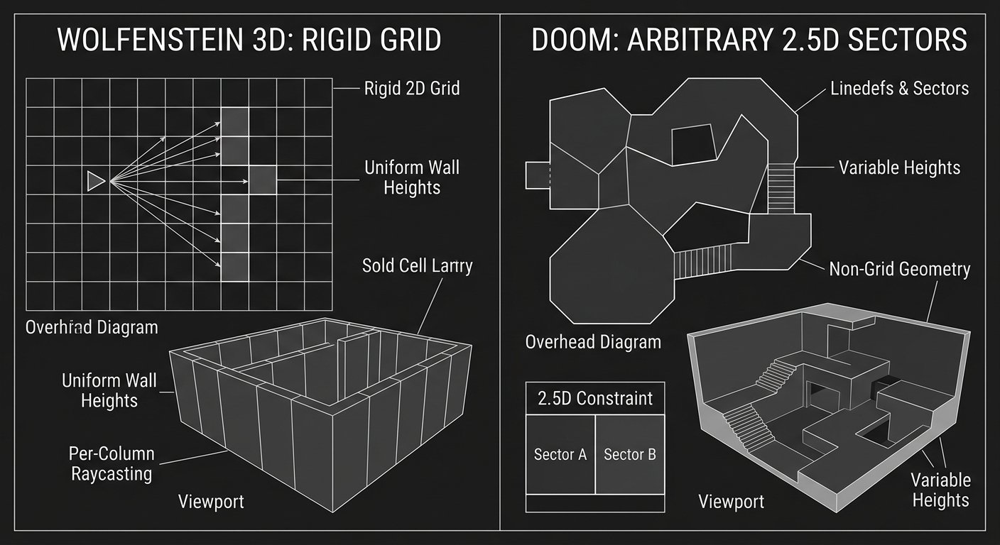
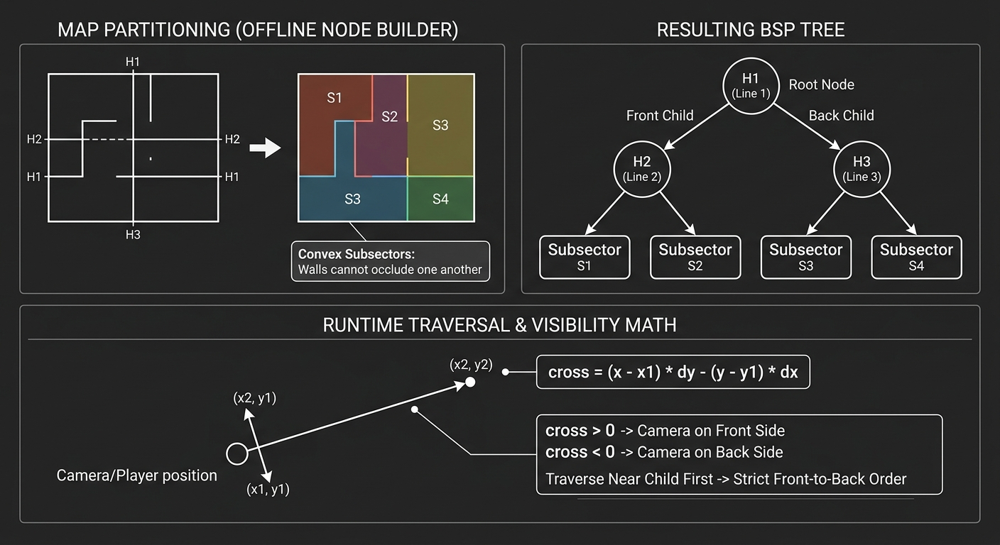
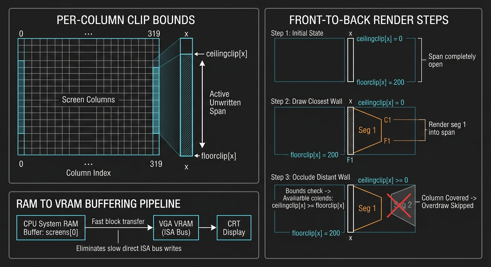
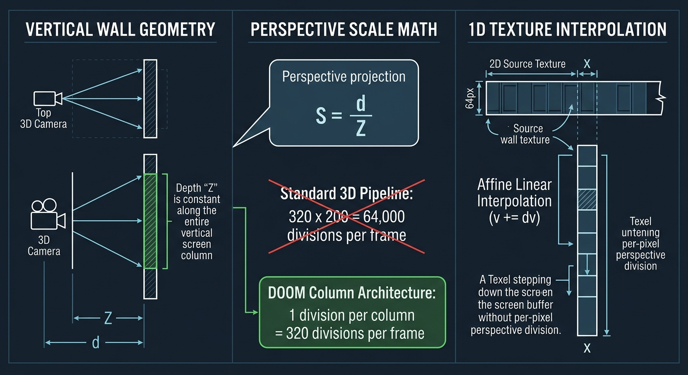
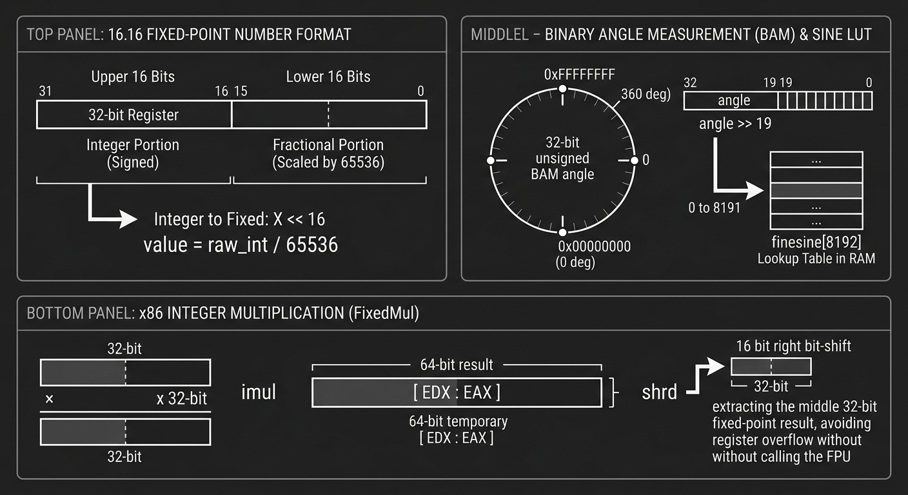

import { Alert } from '@/components/ui/feedback/Alert';
import CodeBlock from '../../../components/ui/content/CodeBlock/CodeBlock.astro';

1993年12月にid Softwareが『DOOM』をリリースした際、最小システム要件にはIntel 386プロセッサが挙げられていました。実際には、このエンジンは特定のハードウェア環境を前提に構築されていました。それは、ハードウェア浮動小数点演算ユニット（FPU）を持たない33MHz動作のIntel 486SXであり、毎秒35ロジックチックで320x200の8ビットフレームバッファを駆動するというものです。ハードウェア3DパイプラインやGPUアクセラレーションが存在しない時代において、幾何変換、可視性クエリ、ピクセル描画はすべて汎用の32ビット整数命令のみで実行されていました。

この計算コストの制限内に収めるため、ジョン・カーマックは標準的な3Dパイプラインを捨て去りました。ジオメトリを垂直な壁と水平な平面に限定することで、3D投影を「1D列のスケーリング」と「事前計算された2D空間ルックアップ」の組み合わせへと変換したのです。

## 1. 1993年のハードウェアのボトルネック

従来の3Dグラフィックスパイプラインは、4x4行列を使用して頂点を変換し、ジオメトリを奥行き順にソートし、任意の多角形にわたって遠近法補正（パースペクティブコレクト）付きテクスチャを補間します。これらは高速な浮動小数点積和演算命令に依存する処理です。

| 制約 | 1993年の典型的なターゲット | レンダリングアーキテクチャへの影響 |
|---|---|---|
| **CPU** | 25〜33 MHzのIntel 386 DXまたは486SX | 浮動小数点演算にはソフトウェアエミュレーションの割り込みが必要だった |
| **ターゲットバジェット** | 35ロジックチック/秒（70 Hz CRTの半分のリフレッシュレート） | レンダリング、AI、移動、オーディオ用に1フレームあたり合計約28.5 ms |
| **ディスプレイモード** | VGA Mode Y（アンチェインド320x200、8ビットインデックスカラー） | ハードウェアページフリッピング用に256 KBのVRAMを提供 |
| **バス帯域幅** | ISAバスのアクセス速度 | VRAMへの直接書き込みが遅く、オーバードローによりメモリスループットが低下した |

<Alert variant="info">
**実践におけるFPUの制約：** Intel 486DX2-66は基本的なジオメトリをスムーズに処理できましたが、linedef（ラインデフ）数の多い広い部屋ではフレームレートが20 FPS未満に落ち込みました。エンジンのアーキテクチャは、整数専用ハードウェア上で安定して動作するように設計されています。
</Alert>

 

実行時に一般的な行列変換を計算する代わりに、カーマックは空間計算を事前コンパイル手順に移行し、実行時の処理を整数テーブルの取得と配列のスキャンに削減しました。

## 2. グリッドから任意ジオメトリへ

idの過去作である『Wolfenstein 3D』（1992年）は、すべての壁を厳密な2Dグリッドにマッピングすることで可視性判定を簡略化していました。レンダラーは画面の列ごとにレイをキャストし、ソリッドブロックに衝突するまでセルを進み、距離に応じてスケーリングされた垂直なテクスチャスライスを描画しました。

『DOOM』は列ベースのレンダリングを継承しつつ、均一なグリッドを**セクター（sectors）**に置き換えました。セクターとは、**linedef（ラインデフ）**と呼ばれる2D線分で囲まれた任意の多角形領域です。各セクターは独自の床高、天井高、フラットテクスチャ（flat textures）、照明レベルを定義します。セクターは非凸形状にしたり、切断したり、高さの異なるセクターと隣接させたりすることができ、階段や段差、吹き抜けの穴などを実現可能にしました。

このアーキテクチャは**2.5D**に分類されます。床と天井は厳密に水平な平面であり、壁は垂直な押し出し形状で、同じ2D水平座標において異なる高さで2つのセクターが重なり合うことはできません。

図1：Wolfenstein 3Dはジオメトリを固定グリッドセルにマッピングしていました。DOOMのセクターモデルは、複雑な可視性問題と引き換えに、任意の壁の角度と可変のセクター高をサポートします。

均一なグリッドが存在しないため、単純なレイキャスティングは非効率的になりました。フレームごとに320個の画面列に対してすべてのlinedefをチェックすることは33 MHzの命令バジェットを超過してしまうため、可視性のソートをオフラインで行う必要がありました。

## 3. 二分空間分割（BSP）ツリー

『DOOM』は、ノードビルダーと呼ばれるツールを使用してマップのコンパイル時に**二分空間分割（BSP：Binary Space Partitioning）ツリー**を構築することで、可視性ソートを解決します。

### 事前計算：マップのコンベックス（凸）サブセクターへの分割

ノードビルダーは2Dマップを分割線に沿って再帰的に分割し、各分割に対して壁セグメントを「表（front）」と「裏（back）」の子セットにソートします。分割は、葉（leaf）が**サブセクター（subsectors）**を形成するまで継続されます。サブセクターとは、その内部のどのカメラ位置から見ても、壁セグメント同士が互いを遮蔽することのない厳密な凸多角形のことです。

点が分割線のどちら側にあるかを判定するには、直線ベクトルとカメラのオフセット間の外積を介して実装された暗黙の2D直線方程式を使用します。

$$
\text{cross} = (x - x_1) \cdot dy - (y - y_1) \cdot dx
$$

各内部ノードは自身の分割線と子のバウンディングボックスを保持し、実行時エンジンが整数の外積を使用して空間位置を評価できるようにします。

図2：サブセクターに分割された2Dマップ。生成された二分ツリーにより、カメラ座標に相対的な手前から奥へのトラバーサル（巡回）が可能になります。

### 実行時トラバーサル：手前から奥への順序

レンダリング中、エンジンはルートノードから開始してBSPツリーを巡回します。各内部ノードで、エンジンは `cross` の符号を評価してカメラが含まれる子ノードを特定します。レンダラーは、**遠く（far）**の子ノードをチェックする前に、まず**手前（near）**の子ノードへ再帰的に進入します。

分割線は観察者に相対的に空間を分割するため、手前の子ノードを優先してツリーを巡回することで、実行時にジオメトリをソートすることなく厳密な手前から奥への順序でサブセクターが出力されます。

## 4. 手前から奥へのオクルージョンとオーバードローの削減

手前から奥へのトラバーサルにより、レンダラーは画面のカバー率を追跡し、ピクセルを描画する前に遮蔽されたジオメトリをクリッピングできます。

画面の320列それぞれに対して、エンジンは2つの境界配列：`ceilingclip` と `floorclip`（`r_segs.c` で定義）を保持します。壁セグメントが描画される際、ラスタライズは `ceilingclip[x]` と `floorclip[x]` の間の未描画の垂直スパンに制限されます。セグメントが描画されると、境界は内側へシフトします。`ceilingclip[x] >= floorclip[x]` になると、列 `x` は完全にカバーされたことになります。

列範囲にわたる水平クリッピングは、ソリッドな区間の配列（`solidsegs`）を使用して追跡されます。壁セグメントを描画したり、遠くのBSPブランチへ深く巡回したりする前に、エンジンはそのスクリーン空間上のバウンディングボックスを `solidsegs` と照合します。範囲がカバーされている場合、そのサブツリーはスキップされます。

図3：手前から奥へ壁セグメントが描画されるにつれて、列ごとのクリップ配列が狭まります。列スパンが閉じると、その背後にある遠くのジオメトリはスキップされます。

<Alert variant="warning">
**システムRAMバッファリング：** 『DOOM』は低速なISAバス経由でVRAM列に直接ラスタライズしません。テクセルは連続したシステムRAMバッファ（`screens[0]`）に書き込まれ、`I_FinishUpdate` 中に単一のブロック転送でVGAメモリにコピーされます。手前から奥へのクリッピングにより、CPUのメモリ書き込みとキャッシュラインの無効化が削減されます。
</Alert>

## 5. 垂直列プロジェクションによるアフィンテクスチャマッピング

壁は厳密に垂直であるため、任意の1画面列において垂直奥行き $Z$ は一様を保ちます。透視歪み補正（パースペクティブコレクト）は、ピクセルごとの処理から1列あたり1回の除算へと大幅に削減されます。

ワールド座標をスクリーン空間にマッピングする垂直スケール因子 $S$ は次の通りです：

$$
S = \frac{d}{Z}
$$

ここで $d$ は投影面の距離、$Z$ は列のレイに沿った垂直距離です。$S$ が評価されれば、列に沿ったテクスチャマッピングは線形補間へと簡略化されます：

図4：垂直な壁の整列により、透視スケール $S = d/Z$ は画面の列ごとに1回評価されます。列の塗りつぶしはアフィンスケーリングループとして実行されます。

透視除算の実行回数は、64,000回（$320 \times 200$）ではなく1フレームあたり320回となります。床および天井の表面（**visplanes**）も同様の水平的アプローチを採用しており、奥行き $Z$ が一定に保たれる画面の行に沿ってスパンを描画します。

## 6. 固定小数点演算と三角関数ルックアップテーブル

座標、スケール因子、レイの方向には**16.16固定小数点**表現が使用されます。これは上位16ビットが整数部分、下位16ビットが小数部分を保持する32ビット符号付き整数であり、`FRACUNIT`（$2^{16} = 65536$）によってスケーリングされます。整数への変換にはビットシフト（$X \ll 16$）が用いられます。

$$
\text{value}_{\text{real}} \approx \frac{\text{raw}_{\text{int32}}}{2^{16}}
$$

加算と減算は標準的な整数演算として実行されます。乗算にはx86の `imul` 命令を使用し、`EDX:EAX` にまたがる64ビットの結果を生成します。レジスタのオーバーフローを防ぐため、`FixedMul` 内部で右に16ビットシフト（`shrd`）されます。

<Alert variant="warning">
**固定小数点の乗算：** 2つの16.16固定小数点を32ビット乗算で直接掛け合わせると、即座にオーバーフローします。エンジンはインラインx86アセンブリを使用して、64ビット拡張乗算とシフトのシークエンスを実行します。
</Alert>

 

角度には、32ビット符号なし整数（`angle_t`）として格納される**バイナリ角度測定（BAM：Binary Angle Measurement）**が使用され、$360^\circ$ は $2^{32}$ にマッピングされます。三角関数は、BAM角度を右に19ビットシフト（`angle >> 19`）することで、事前計算されたルックアップテーブル（8192個のエントリを持つ `finesine[]`）をインデックス参照します。

図5：16.16固定小数点数のビットレイアウト。BAM角度は32ビット整数値にマッピングされ、`angle >> 19` を介してルックアップテーブルをインデックス参照します。

以下のコードは、`r_bsp.c` に基づくBSPツリーのトラバーサル、側面判定、およびバウンディングボックスのチェックを示しています：

export const cCodeSnippet = `// r_bsp.c に基づくコア BSP トラバーサルロジック（id Software, 1993年）。

#define NF_SUBSECTOR 0x8000  // ビット15は葉（サブセクター）インデックスを示す

void R_RenderBSPNode(int bspnum)
{
    node_t *bsp;
    int     side;

    // 葉に到達：ノードインデックスがサブセクターを参照
    if (bspnum & NF_SUBSECTOR)
    {
        if (bspnum == -1)
            R_Subsector(0);
        else
            R_Subsector(bspnum & (~NF_SUBSECTOR));
        return;
    }

    bsp = &nodes[bspnum];

    // 分割線に対するカメラの側面を判定
    side = R_PointOnSide(viewx, viewy, bsp);

    // 手前から奥への描画順序のため、手前のサブツリーを先に処理
    R_RenderBSPNode(bsp->children[side]);

    // 蓄積されたソリッド範囲に対して遠くのサブツリーのバウンディングボックスをテスト
    if (R_CheckBBox(bsp->bbox[side ^ 1]))
        R_RenderBSPNode(bsp->children[side ^ 1]);
}
`;

<CodeBlock code={cCodeSnippet} filename="r_bsp.c" showLineNumbers={true} />

## 7. システムアーキテクチャへの影響

『DOOM』のレンダリングパイプラインは、アルゴリズムの制約がCPUのボトルネックにいかに適応できるかを示しています。3Dの可視性判定を2D空間ツリーへと縮小し、2Dテクスチャを1Dの垂直スケーリングでマッピングし、16.16固定小数点演算を使用することで、このエンジンは標準的な386および486ハードウェア上でリアルタイムの疑似3Dグラフィックスを実現しました。

これらの最適化は、将来のエンジンアーキテクチャの基礎を築きました。BSPツリーやPVS（Potentially Visible Sets：潜在的可視セット）のような空間分割構造は1990年代の3Dエンジンのコアコンポーネントとなり、初期のスパンクリッピング（span clipping）によって確立された概念は、現代のGPUにおけるハードウェアオクルージョンクエリやEarly-Zリジェクション（Early-Z剪定）へと進化しました。

---

## 参考文献・関連資料

* **Sanglard, F.** <a href="https://fabiensanglard.net/gebbdoom/" target="_blank" rel="noopener noreferrer">*Game Engine Black Book: DOOM*</a>. 1993年のDOOMエンジンアーキテクチャ、固定小数点演算、VGAハードウェアパイプラインの技術的解説。
* **id Software.** <a href="https://github.com/id-Software/DOOM" target="_blank" rel="noopener noreferrer">*DOOM Source Code Release*</a>. GitHub. `r_bsp.c`、`r_segs.c`、`tables.c` を含む、1997年に公開されたオリジナルのGPLソースコード。
* **Abrash, M.** <a href="https://github.com/jagregory/abrash-black-book" target="_blank" rel="noopener noreferrer">*Michael Abrash's Graphics Programming Black Book*</a>. VGAプログラミング、x86アセンブリの最適化、BSPツリーに関するローレベルのリファレンス。
* **Wikipedia.** <a href="https://en.wikipedia.org/wiki/Binary_space_partitioning" target="_blank" rel="noopener noreferrer">*Binary Space Partitioning*</a>. BSPツリーの構築と空間分割に関する一般的な背景知識。

---

## 技術用語集

| 用語 | 定義 |
|---|---|
| **BSPツリー（二分空間分割）** | 分割線に沿って2Dマップを再帰的に分割する事前計算された二分ツリー。実行時のソートなしで手前から奥へのトラバーサル（巡回）を可能にする。 |
| **サブセクター（Subsector）** | BSPツリーの葉にあたる厳密な凸多角形領域であり、互いを遮蔽する内部壁セグメントが含まれないことが保証されている。 |
| **オーバードロー（Overdraw）** | 同じフレーム内で、後から描画される手前のジオメトリによって上書きされてしまう画面ピクセルへ書き込むこと。 |
| **アフィンテクスチャマッピング** | ピクセル単位ではなく、列または行ごとに1回だけ透視歪み補正（パースペクティブコレクト）を行うテクスチャマッピング技法。 |
| **固定小数点演算（16.16）** | 整数部分に16ビット、小数部分に16ビットを使用する32ビット整数表現。FPUの必要性を回避する。 |
| **FRACUNIT** | 標準的な整数とDOOMの16.16固定小数点表現との間で変換を行うために使用されるスケール定数（$2^{16} = 65536$）。 |
| **BAM（バイナリ角度測定）** | `angle_t`（32ビット符号なし整数）を使用した角度表現法。$360^\circ$ が $2^{32}$ のラップアラウンドにマッピングされ、`angle >> 19` を介してLUTをインデックス参照する。 |
| **LUT（ルックアップテーブル）** | 実行時の関数呼び出しをテーブルからの値の取得に置き換えるために使用される、事前計算された値（正弦、余弦、正接）の配列。 |
| **Mode Y（プレナーVGA）** | ハードウェアによるトリプルバッファリングのページフリッピングと高速なブロック書き込みのために256 KBのVRAMを利用可能にする、VGA Mode 13h（320x200、256色）のアンチェインド変種。 |
| **2.5D** | 2Dの間取り図からジオメトリが垂直に押し出されるレンダリングモデル。真の上下に重なった3D空間を構成することはできない。 |